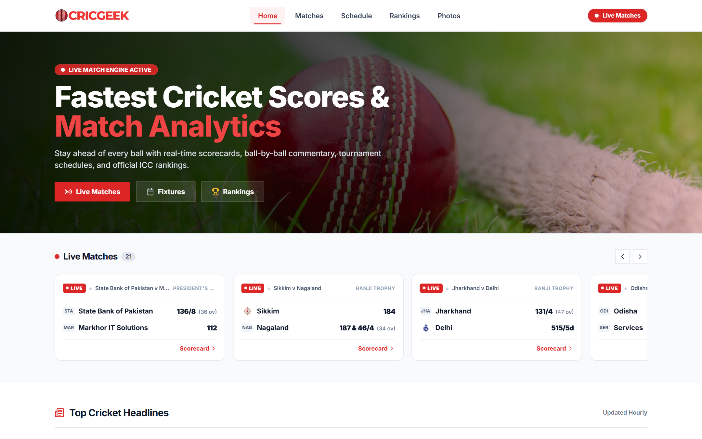
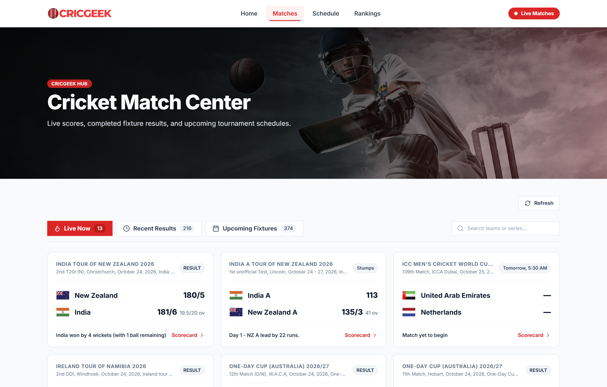
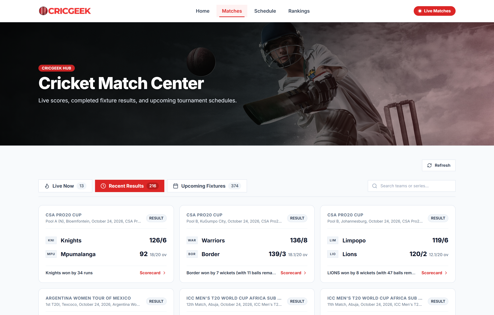
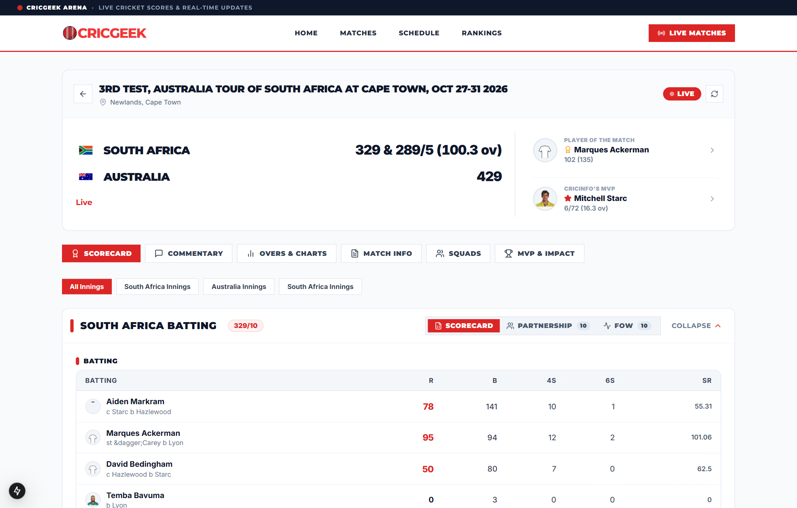
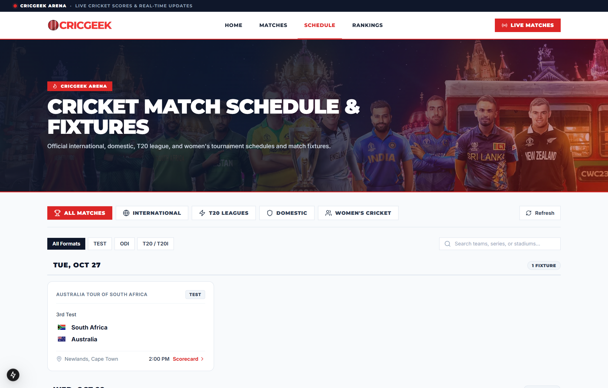
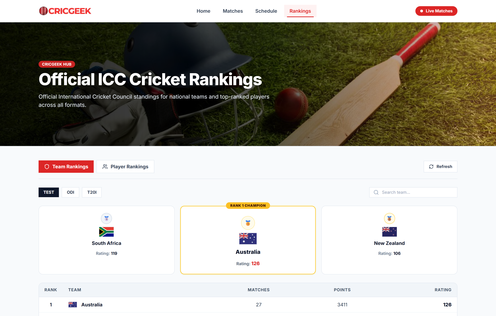
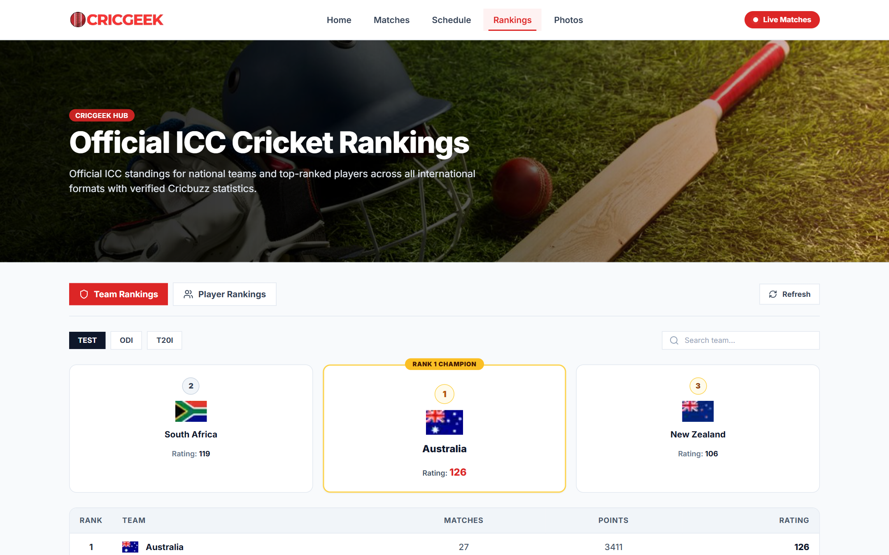
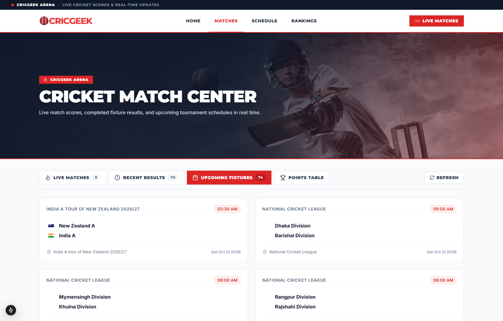

# 🏏 CricGeek — Next-Gen Cricket Hub

**CricGeek** is a high-octane, athletic sports web application engineered with **Next.js 15 (App Router)**, **React 19**, **TypeScript**, and **Tailwind CSS**. It connects directly to the companion **[Cricket-Api](https://github.com/Abhip32/Cricket-Api)** to deliver real-time ball-by-ball updates, live match scorecards, player impact analytics (MVP), Cricbuzz photo galleries, tournament schedules, official ICC rankings, and breaking news.



---

## 📸 Application Showcase & Screenshots

### 🏠 Match Center & Fixtures
| Home Dashboard | Live Match Center (2-Col Layout) | Completed Fixtures & Results |
|:---:|:---:|:---:|
|  |  |  |

### 📊 Scorecard Tabs & In-Depth Analytics
| Scorecard: Batting & Bowling Breakdown | Scorecard: MVP & Player Impact Leaderboard | Scorecard: Ball-by-Ball Commentary & Over Timeline |
|:---:|:---:|:---:|
|  |  |  |

### 📋 Match Info, Tournament Schedules & Photo Galleries
| Scorecard: Match Info & Playing XI | Tournament Schedule & Fixtures | Cricbuzz High-Res Photo Galleries |
|:---:|:---:|:---:|
|  |  |  |

### 🏆 Official ICC Rankings
| Official ICC Team Rankings | ICC Player Rankings (Batting / Bowling / All-Rounder) | Upcoming Fixtures (ESPN Powered) |
|:---:|:---:|:---:|
|  |  |  |

---

## ✨ Features & Architecture Highlights

### 🔴 1. Athletic Editorial Styling
- **Theme & Palette**: High-contrast athletic sports design inspired by ThemeWagon athletic layouts and Cricinfo editorial standards — deep stadium black (`#070B14`), pure white, and athletic crimson red (`#DC2626`).
- **Free-Floating Flags**: National and club flags render freely without artificial box enclosures, borders, or forced aspect-ratio distortion (`object-contain`).
- **Clean 2-Column Match Grid**: Engineered with a responsive 2-column layout (`grid-cols-1 md:grid-cols-2`) that prevents header truncation while keeping team names and match information prominent and legible.
- **Zero Redundant Tags**: Removed duplicate "Live" indicators — clean badges on top with crisp match status in the card body.

### 📱 2. Mobile-First Responsive Controls
- **Segmented Pill Navigation**: Replaced clunky mobile `<select>` dropdowns with responsive, horizontal scrolling segmented pill tabs (`Live Matches`, `Recent Results`, `Upcoming Fixtures`).
- **Unified Card Controls**: Removed cluttered breadcrumbs and detached top navigation bars. The back navigation (`ArrowLeft`) and instant manual refresh (`RefreshCw`) are cleanly built directly into the header banner of the match summary card (`MiniScoreCard`).
- **Zero Auto-Polling Overhead**: No background CPU drain or unwanted refetch spikes (`refetchInterval: false`, `refetchOnWindowFocus: false`). Users enjoy instant on-demand manual refreshing whenever desired.

### 📊 3. Complete Scorecard Suite (All Tabs)
- **Scorecard Tab**: Full batting innings with player dismissal methods, runs, balls, 4s, 6s, and strike rates (with 50s/100s milestones), plus bowling tables with overs, maidens, runs, wickets, and economy rates.
- **MVP & Player Impact Tab**: Proprietary impact algorithm evaluating runs scored, strike-rate bonuses, wickets taken, economy rewards, and maiden bonuses. Features a top-3 podium (🥇, 🥈, 🥉) and rated player leaderboard.
- **Commentary Tab**: Redesigned timeline spine with ball outcome pills (`W` in red, `4` in blue, `6` in purple), bowler-to-batter matchup headlines, over summary strips, and instant filter pills (`All Balls`, `Wickets`, `Boundaries`).
- **Match Info & Squads Tab**: Venue information, series details, toss report, match status, and official playing XI lineups with Captain (`(c)`) and Wicketkeeper (`(wk)`) badges.

### 📸 4. Cricbuzz Photo Galleries (`/photos`)
- Sourced directly from Cricbuzz photo galleries.
- High-resolution photography (`750x422`) with album collections, individual gallery views, photo counts, and descriptive photo captions.

### 📅 5. ESPN-Powered Fixtures & Tournament Schedule
- **Upcoming Matches**: Powered 100% by ESPN Cricinfo official API, ensuring complete match details and hiding premature scorecard links.
- **Tournament Schedule**: Dedicated tournament schedule endpoint (`/schedule`) categorized by International, Domestic, and T20 Leagues with live search filters.

### 🏆 6. Official ICC Rankings
- Toggles between Team Rankings and Player Rankings (Batting, Bowling, All-rounders) across **Test**, **ODI**, and **T20I**.
- Properly renders player names, ratings, nationalities, and headshots with podium styling.

---

## 🚀 Getting Started

### 1. Prerequisites
- **Node.js** v18+ (tested on Node v20 & v22)
- **Cricket-Api** backend running on port `8000`

### 2. Start Backend API
```bash
cd Cricket-Api
npm install
npm start
# Backend starts at http://localhost:8000
```

### 3. Start CricGeek Frontend
```bash
cd CricGeek
npm install
npm run dev
# Frontend starts at http://localhost:3000
```

### 4. Production Build
```bash
npm run build
npm start
```

---

## 🛠️ Tech Stack

- **Framework**: Next.js 15 (App Router)
- **UI Library**: React 19
- **Language**: TypeScript
- **Styling**: Tailwind CSS with custom glassmorphism and athletic sports utilities
- **Animations**: Framer Motion
- **Icons**: Lucide React
- **Data Source**: [Cricket-Api](https://github.com/Abhip32/Cricket-Api) Express & Puppeteer scraper

---

## 📁 Project Structure

```
CricGeek/
├── screenshots/                  # High-resolution application screenshots
├── src/
│   ├── app/
│   │   ├── layout.tsx            # Global Root Layout with athletic theme
│   │   ├── page.tsx              # Home Dashboard with carousel & news desk
│   │   ├── matches/              # Live, Recent, and Upcoming matches
│   │   ├── scorecard/            # Scorecard tabs (Batting, MVP, Commentary, Squads)
│   │   ├── rankings/             # Official ICC Team & Player leaderboards
│   │   ├── schedule/             # Dedicated tournament schedule & calendar
│   │   └── photos/               # Cricbuzz photo galleries & albums
│   ├── components/
│   │   ├── common/               # Navbar, Footer, ImageWithFallback, Skeletons
│   │   ├── home/                 # MatchCarouselCard, NewsSection
│   │   ├── matches/              # MatchCard (2-col grid, free flags)
│   │   ├── scorecard/            # MiniScoreCard, ScorecardTab, MvpTab, CommentaryTab, SquadsTab
│   │   └── rankings/             # RankingPodium, RankingsTable
│   ├── hooks/
│   │   └── useCricketQueries.ts  # TanStack React Query hooks (zero auto-poll)
│   ├── services/
│   │   └── api.ts                # API client with data normalizers
│   └── types/
│       ├── match.ts              # Match, Series, Scorecard, and Commentary types
│       └── news.ts               # News article types
├── public/                       # Static public assets
└── package.json                  # Dependencies & scripts
```

---

## 👨‍💻 Author

Created & Maintained by **[Abhip32](https://github.com/Abhip32)**
